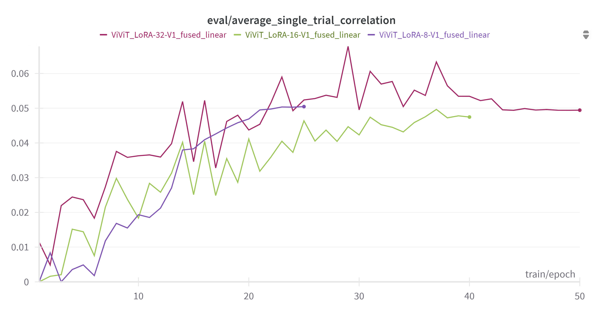
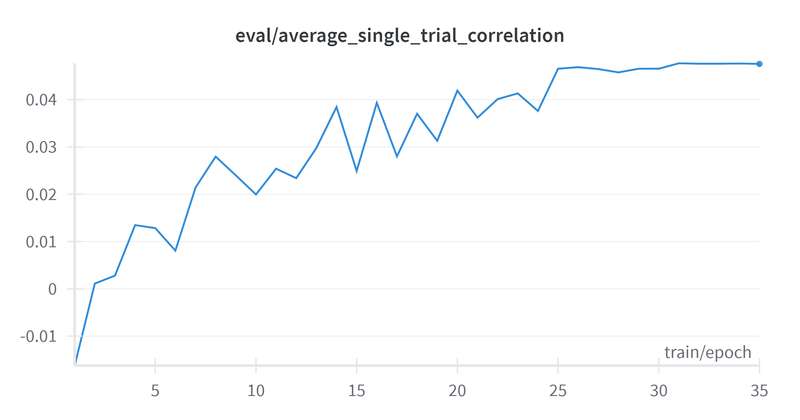
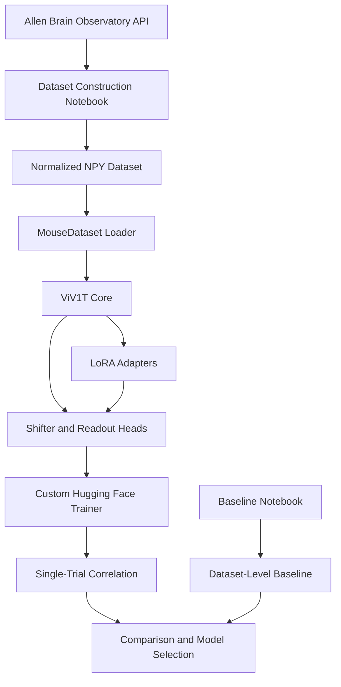
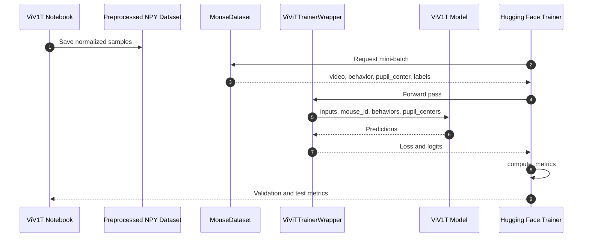

# Brain Encoding with ViV1T


Reference implementation for predicting mouse visual cortex responses from natural
movies. The project combines the publicly available ViV1T video transformer with two
complementary workflows: a dataset-level trial-averaged baseline and
parameter-efficient fine-tuning with LoRA adapters. The repository reproduces the
complete pipeline, from Allen Brain Observatory data construction to checkpoint
evaluation with single-trial correlation.

## Overview

The codebase is organized as two executable notebooks. The baseline notebook
establishes how much response variance is explained by the trial-averaged stimulus
response alone. The ViV1T notebook builds the dataset, adapts the pretrained model,
trains the prediction heads with optional LoRA adapters, and compares the resulting
checkpoints against the baseline.

**Key features**

- End-to-end construction of a mouse brain-encoding dataset from the Allen Brain
  Observatory API.
- Reproducible trial-averaged baseline evaluated on held-out trials.
- Transfer learning from a pretrained ViV1T checkpoint.
- LoRA fine-tuning of fused linear projections with configurable rank and alpha.
- Custom Hugging Face Trainer integration for the non-standard ViV1T forward
  signature.
- Single-trial correlation metric with variance-based neuron filtering.
- Published checkpoints and experiment tracking through Hugging Face Hub and Weights
  & Biases.

### Reported results

Single-trial correlation on the test split. Higher is better. The ratio is computed
against the dataset-level baseline.

| Configuration | Adapted modules | Test correlation | Ratio vs baseline |
| --- | --- | ---: | ---: |
| Dataset-level baseline | — | 0.023535 | 1.00x |
| Shifter and readout only | — | 0.017828 | 0.76x |
| LoRA-8, epoch 35 | `fused_linear` | 0.042100 | 1.79x |
| LoRA-16, V2 | `fused_linear`, `attn_out`, `ff_out.2` | 0.039630 | 1.68x |
| LoRA-32, V1 | `fused_linear`, `attn_out`, `ff_out.2` | 0.038519 | 1.64x |

The metric is the mean Pearson correlation across neurons between predicted and
recorded responses on held-out trials. It is computed on the last 66 frames of each
clip, and neurons with near-zero variance in either signal are excluded to avoid
undefined coefficients.

The full checkpoint comparison, including all evaluated variants, is reported in
`brain-encoding-viv1t.ipynb` and in the [project report](Project%20Report.pdf).

### Training curves

| MLP shifter and readout | LoRA comparison |
| --- | --- |
|  |  |
|  |  |

## System Architecture

The pipeline separates data construction, model adaptation, training, and evaluation.
`MouseDataset` provides a uniform tensor interface over the four preprocessed
modalities. `ViV1TWrapper` adapts the ViV1T forward signature to the PEFT interface,
and `ViViTTrainerWrapper` adapts the resulting model to the Hugging Face Trainer
contract. `CustomViViTTrainer` overrides the prediction step so that evaluation
returns the model outputs expected by the correlation metric.



The training and evaluation sequence is shown below.



**Design notes**

- The four modalities are stored as parallel `.npy` files with numeric identifiers.
  This keeps the dataset layout simple and allows modality-specific normalization.
- Videos are resized to 36 x 64 pixels, segmented into 140-frame clips, and
  normalized with min-max scaling. Behavior and pupil features use min-max scaling,
  while fluorescence traces are scaled by their standard deviation.
- The last 66 frames of each sample are used for evaluation. Neurons with
  near-zero variance in either prediction or label are excluded because their
  Pearson correlation is undefined.
- LoRA adapters target `fused_linear` projections by default; attention output and
  feed-forward output projections were evaluated in separate runs.

### Repository structure

```text
Brain-Encoding--ViV1T/
├── brain-encoding-baseline.ipynb   # Baseline dataset loader, trial-averaged correlations, final baseline
├── brain-encoding-viv1t.ipynb      # Dataset construction, ViV1T training, LoRA experiments, evaluation
├── Charts/
│   ├── MLPShifter&Readout/         # Training loss and correlation curves for the head-only model
│   ├── LoRA-8/                     # LoRA rank 8 training and evaluation curves
│   ├── LoRA-16/                    # LoRA rank 16 training and evaluation curves
│   ├── LoRA-32/                    # LoRA rank 32 training and evaluation curves
│   └── LoRA-comparison/            # Cross-rank comparison plots
├── Project Report.pdf              # Methodology, experiments, and discussion
├── README.md                       # Project documentation
└── .gitattributes                  # Line-ending normalization
```

## Prerequisites

- **Python 3.11** (the notebooks were executed with Python 3.11.13).
- **CUDA-capable GPU** for ViV1T training. The baseline notebook runs on CPU.
- **JupyterLab or Jupyter Notebook**.
- **Kaggle** account and notebook environment for the default configuration. The
  notebooks use Kaggle input mounts, Kaggle Secrets, and a GPU runtime.
- Access to the following external assets:
  - Preprocessed mouse dataset, or the raw Allen Brain Observatory data used to
    build it.
  - Pretrained ViV1T package and checkpoint.

The main Python dependencies are:

```text
allensdk
huggingface_hub
jupyter
matplotlib
numpy
pandas
peft
safetensors
scipy
torch
tqdm
transformers
wandb
```

## Installation

1. Create and activate a virtual environment.

   ```bash
   python3.11 -m venv .venv
   source .venv/bin/activate
   python -m pip install --upgrade pip
   ```

2. Install the Python dependencies.

   ```bash
   pip install numpy pandas matplotlib scipy tqdm jupyter
   pip install torch transformers peft wandb huggingface_hub safetensors allensdk
   ```

3. Install the ViV1T package from its upstream repository.

   ```bash
   git clone https://github.com/bryanlimy/ViV1T.git vendor/ViV1T
   pip install -e vendor/ViV1T
   ```

4. Launch JupyterLab from the repository root.

   ```bash
   jupyter lab
   ```

### Kaggle setup

1. Import both notebooks into a Kaggle notebook.
2. Attach the preprocessed dataset as `mousedatasetct`.
3. Attach the ViV1T assets as `viv1t`; the expected version path is
   `/kaggle/input/viv1t/transformers/default/6/`.
4. Enable a GPU accelerator and internet access.
5. Add `WANDB_API_KEY` and `HF_HUB_TOKEN` to Kaggle Secrets.

## Configuration

### Environment variables

| Variable | Required | Purpose |
| --- | --- | --- |
| `WANDB_API_KEY` | For training | Authenticates Weights & Biases logging. |
| `HF_HUB_TOKEN` | For checkpoint download/upload | Authenticates Hugging Face Hub operations. |

The ViV1T notebook reads both values through `UserSecretsClient`:

```python
import os
from kaggle_secrets import UserSecretsClient

secrets = UserSecretsClient()
os.environ["WANDB_API_KEY"] = secrets.get_secret("WANDB_API_KEY")
os.environ["HF_HUB_TOKEN"] = secrets.get_secret("HF_HUB_TOKEN")
```

For local execution, export the same variables in the shell instead.

### Paths and notebook constants

| Setting | Default value | Description |
| --- | --- | --- |
| Training data | `/kaggle/input/mousedatasetct/train/data` | Training split consumed by `MouseDataset`. |
| Validation data | `/kaggle/input/mousedatasetct/validation/data` | Validation split used for model selection. |
| Test data | `/kaggle/input/mousedatasetct/test/data` | Held-out split used for final evaluation. |
| ViV1T arguments | `/kaggle/input/viv1t/transformers/default/6/args.py` | Model configuration loaded at runtime. |
| ViV1T weights | `/kaggle/input/viv1t/transformers/default/6/model_state.pt` | Pretrained core checkpoint. |
| Hugging Face repository | `Prv2106/ViV1T-Brain-Encoding-All-Experiments` | Published experiment checkpoints. |
| W&B project | `Brain-Encoding-ViV1T-Trainings` | Experiment tracking project. |
| Mouse identifier | `A` | Key used for the neuron coordinate dictionary. |
| Evaluation frames | `66` | Number of trailing frames used by the metric. |

### Dataset layout

Each split must follow the same directory contract:

```text
data/
├── videos/
│   ├── 0.npy
│   └── ...
├── pupil_center/
│   ├── 0.npy
│   └── ...
├── behavior/
│   ├── 0.npy
│   └── ...
└── labels/
    ├── 0.npy
    └── ...
```

Array shapes used by the notebooks:

| Modality | On disk | After `MouseDataset` |
| --- | --- | --- |
| Video | `(140, 36, 64)` | `(1, 140, 36, 64)` |
| Pupil center | `(140, 2)` | `(2, 140)` |
| Behavior | `(140, 2)` | `(2, 140)` |
| Neural labels | `(227, 140)` | `(227, 140)` |

### Training defaults

| Parameter | Head-only | LoRA + head |
| --- | ---: | ---: |
| Epochs | 30 | 30 |
| Learning rate | `1e-2` | `1e-3` |
| Train batch size | 1 | 1 |
| Eval batch size | 1 | 1 |
| Weight decay | 0.01 | 0.01 |
| Scheduler | Cosine | Cosine |
| Mixed precision | FP16 | FP16 |
| Model selection metric | `eval_average_single_trial_correlation` | `eval_average_single_trial_correlation` |

LoRA defaults: rank 8, alpha 16, dropout 0.1, no bias, task type
`FEATURE_EXTRACTION`, and `fused_linear` as the target module.

## Usage

### Baseline evaluation

Open and run `brain-encoding-baseline.ipynb` from top to bottom. The notebook loads
the preprocessed splits, computes trial-averaged responses for all 31 clips, and
compares them with test trials 8 and 9.

Expected final output:

```text
Baseline among all data: 0.0235345645802377
```

### Dataset construction and ViV1T training

Open `brain-encoding-viv1t.ipynb` and execute the cells in order. The notebook is
organized into the following sections:

1. **Dataset Construction**: downloads the Allen Brain Observatory session, resizes
   and segments videos, extracts behavior and pupil data, normalizes all modalities,
   and writes the train, validation, and test splits.
2. **Neuron Coordinates Computation**: derives ROI centroids and converts them to the
   Sensorium coordinate system.
3. **Model Configuration**: loads the ViV1T arguments and pretrained core weights.
4. **PEFT LoRA**: wraps ViV1T for PEFT and configures the adapters.
5. **Custom Hugging Face Trainer**: defines the training wrapper and the
   single-trial correlation metric.
6. **Head Training**: freezes the core and trains the shifter and readout heads.
7. **LoRA and Head Fine-Tuning**: trains LoRA adapters together with the prediction
   heads.
8. **Results Relative to the Baseline**: restores published checkpoints and compares
   their test scores with the baseline.

### Headless execution

After the Kaggle inputs and secrets are available, the notebooks can be executed
without the interactive interface:

```bash
jupyter nbconvert --to notebook --execute brain-encoding-baseline.ipynb \
  --output baseline-executed.ipynb

jupyter nbconvert --to notebook --execute brain-encoding-viv1t.ipynb \
  --output viv1t-executed.ipynb
```

Dataset construction requires internet access and can take several minutes. Training
requires a CUDA-capable GPU.

### Downloading a published checkpoint

The following snippet retrieves the best LoRA-8 checkpoint without running the full
training pipeline. Model construction and evaluation follow the cells in
`brain-encoding-viv1t.ipynb`.

```python
import os
from huggingface_hub import hf_hub_download
from safetensors.torch import load_file

checkpoint_path = hf_hub_download(
    repo_id="Prv2106/ViV1T-Brain-Encoding-All-Experiments",
    filename=(
        "experiments/LoRA-8-V2_shifter_mode2_MSE_ct_fused_alpha=16_epoch=35/"
        "checkpoint-7161/model.safetensors"
    ),
    token=os.environ["HF_HUB_TOKEN"],
)

state_dict = load_file(checkpoint_path)
```

### Reported checkpoint comparison

| Rank and adaptation | Checkpoint | Test correlation |
| --- | --- | ---: |
| Head only | `Head-V2_MSE_ct_cosine/checkpoint-6727` | 0.017828 |
| LoRA-8, all target modules | `LoRA-8-V1_shifter_mode2_MSE_ct/checkpoint-5425` | 0.033520 |
| LoRA-8, `fused_linear` only | `LoRA-8-V2_shifter_mode2_MSE_ct_fused_alpha=16/checkpoint-5425` | 0.035450 |
| LoRA-8, `fused_linear` only, epoch 35 | `LoRA-8-V2_shifter_mode2_MSE_ct_fused_alpha=16_epoch=35/checkpoint-7161` | 0.042100 |
| LoRA-16, all target modules, V1 | `LoRA-16-V1_MSE_ct/checkpoint-6510` | 0.037442 |
| LoRA-16, all target modules, V2 | `LoRA-16-V2_MSE_ct/checkpoint-5425` | 0.039630 |
| LoRA-16, `fused_linear` only | `LoRA-16-V1_MSE_shifter_mode2_fused_cosine/checkpoint-6727` | 0.027406 |
| LoRA-16, `fused_linear` only, epoch 40 | `LoRA-16-V1_MSE_shifter_mode2_fused_cosine_epoch=40/checkpoint-8029` | 0.029424 |
| LoRA-32, all target modules, V1 | `LoRA-32-V1_MSE_ct/checkpoint-6727` | 0.038519 |
| LoRA-32, all target modules, V2 | `LoRA-32-V2_MSE_ct/checkpoint-6727` | 0.027103 |
| LoRA-32, `fused_linear` only, epoch 50 | `LoRA-32-V1_shifter_mode2_MSE_ct_fused_cosine_epoch=50/checkpoint-6293` | 0.033201 |

## Verification

The repository does not include an automated test suite. The notebooks are the
executable specification. To verify an environment:

1. Run `brain-encoding-baseline.ipynb` and confirm the baseline value reported above.
2. Run the evaluation cells in `brain-encoding-viv1t.ipynb` and confirm that the
   published checkpoints reproduce the reported scores within numerical tolerance.
3. Confirm that the generated plots match the reference curves in `Charts/`.

Validation plots for each experiment are stored in `Charts/`; the full methodology
and discussion are available in [Project Report.pdf](Project%20Report.pdf).

## Acknowledgements

- [ViV1T](https://github.com/bryanlimy/ViV1T) for the video transformer backbone.
- The Allen Institute for Brain Science for the Brain Observatory dataset and the
  Allen SDK.
